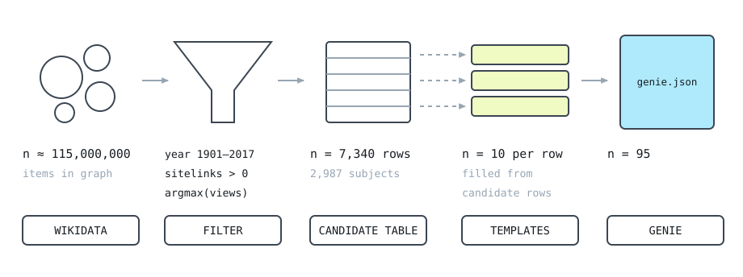
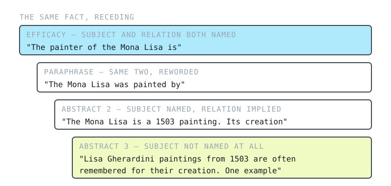
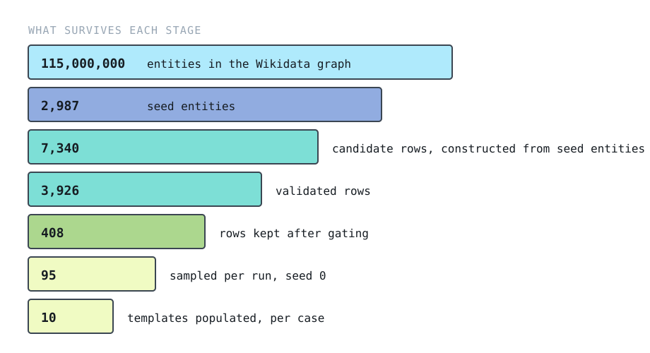

# GENIE: GENeralisation In Edits

A benchmark for model editing that asks whether an edited language model can **use** a new fact, not just **recall** it.

Existing editing benchmarks mostly check that the model repeats the edited fact when asked directly. GENIE pairs every edit with a ladder of probes that move progressively further from the edit prompt: reworded, chained through related facts, and finally abstracted so the subject is no longer named at all. If an edit has changed what the model knows, the new fact should surface at every rung.

Built for my MSc thesis, *Model editing: capacities and limits* (Birkbeck, University of London, 2026). Code for the thesis: [BBK-model-editing-final-report](https://github.com/benji-benji/BBK-model-editing-final-report).

**Dataset on Hugging Face:** [benji-benji/genie](https://huggingface.co/datasets/benji-benji/genie)



## What is in a case

Each case is one counterfactual edit (subject, relation, old object → new object) plus up to ten probes. Facts come from Wikidata, using the relation set from RippleEdits.

```json
{
  "case_id": "composer_662",
  "subject": "E.T. the Extra-Terrestrial",
  "relation": "composer",
  "prompt": "The name of the composer of {} is",
  "target_old": "John Williams",
  "target_new": "James Newton Howard",
  "meta": {"pid": "P86", "frame": "work", "year": 1982, "location": "United States", "sitelinks": 69},
  "probes": [
    {"category": "efficacy", "prompt": "The name of the composer of E.T. the Extra-Terrestrial is", "answer_old": ["John Williams"], "answer_new": ["James Newton Howard"]},
    {"category": "hop_1", "prompt": "The place of birth of the composer of E.T. the Extra-Terrestrial is", "answer_old": ["New York City"], "answer_new": ["Los Angeles"]},
    {"category": "abstract_1", "prompt": "Which of Fantastic Beasts and Where to Find Them (film) and Saving Private Ryan has the same composer as E.T. the Extra-Terrestrial? The answer is", "answer_old": ["Saving Private Ryan"], "answer_new": ["Fantastic Beasts and Where to Find Them (film)"]},
    {"category": "abstract_3", "prompt": "Steven Spielberg films from 1982 are often remembered for their music. One example", "answer_old": ["John Williams", "Williams"], "answer_new": ["James Newton Howard", "Howard"], "constraints": ["year", "person"]}
  ]
}
```

Four of this case's 8 probes are shown; the others are `paraphrase_1`, `paraphrase_2`, `paraphrase_3`, `abstract_2`.

| Probe | What it asks |
|---|---|
| `efficacy` | The edit prompt itself |
| `paraphrase_1`–`3` | The same question, reworded at increasing length and indirection |
| `hop_1`–`3` | A chained question about the edited object, one to three properties deep (e.g. the birthplace of the composer of *E.T.*) |
| `abstract_1` | A forced choice between two other entities: one that shares the old object, one that shares the new (e.g. which of two films has the same composer as *E.T.*) |
| `abstract_2` | Open generation one rung up: the subject is named, but the relation is described in more general terms |
| `abstract_3` | Open generation with the subject removed, identified only by constraints such as year and creator |

`abstract_2` and `abstract_3` have no gold continuation. They are scored by generating 20 tokens and checking whether an accepted answer appears as a whole word.



## Files

Two versions are published. **v2 is the recommended version.** v1 is the data exactly as evaluated in the thesis, kept so those results can be reproduced.

| File | v2 records | v2 probes | v1 records | v1 probes |
|---|---|---|---|---|
| `genie.jsonl` — full benchmark, 43 relations | 7,340 | 48,533 | 7,340 | 48,795 |
| `genie_gpt2-xl.jsonl` — GPT-2-XL evaluation set | 67 | 465 | 95 | 680 |
| `genie_llama3-8b.jsonl` — LLaMA-3-8B evaluation pool | 375 | 2,771 | 390 | 2,880 |

Files live in `data/hf/v2/` and `data/hf/v1/`. v1 `genie.jsonl` is `data/raw/genie/genie.json` unchanged, one case per line.

### What changed in v2

Some `abstract_2` and `abstract_3` prompts already contain the answer they are scored on. These prompts identify the subject through a related person, and for director, composer and screenwriter edits that person can be the answer itself: *"Akira Kurosawa films from 1950 are often remembered for their production. One example"* is scored on whether "Akira Kurosawa" appears in the output.

A model can produce such an answer by copying it from the prompt, so these probes do not test what the model knows. v2 removes every `abstract_2` and `abstract_3` probe whose prompt contains one of its old answers as a whole word (`abstract_1` names both candidates by design and is unaffected), then re-applies the `abstract_3` stratification to the per-model sets.

| Set | `abstract_2` removed | `abstract_3` removed | Cases removed |
|---|---|---|---|
| Full | 148 of 7,025 | 114 of 3,032 | 0 |
| GPT-2-XL | 18 of 51 | 28 of 95 | 28 of 95 |
| LLaMA-3-8B | 7 of 278 | 15 of 390 | 15 of 390 |

The GPT-2-XL set is affected most because of how it was built: the per-model filter keeps probes where the unedited model produced the old answer, and copying from the prompt is an easy way to do that. In the thesis, roughly 3 in 10 GPT-2-XL `abstract_3` probes therefore asked for the new answer while naming the old one in the prompt.

### How the per-model sets are built

A free-text probe can only show an edit if the model could produce the original answer before editing. Each model was therefore run once over every `abstract_2` and `abstract_3` probe, unedited; the results are in `artifacts/bench_generation/genie_surfacing_<model>.json`. The per-model sets drop probes that never surfaced, then keep only cases that still hold an `abstract_3` probe. Both versions are rebuilt from the committed surfacing results, with no model runs:

```bash
uv run python -m genie_bench.scripts.genie_export
```

v1 GPT-2-XL is exactly the 95 cases evaluated in the thesis; v1 LLaMA-3-8B is the 390-case pool from which the thesis drew a seeded sample of 95.



## Rebuilding from scratch

The cached seed lists and table are committed, so each step reuses them unless deleted.

```bash
uv sync
uv run python -m genie_bench.ripple_get_most_viewed            # seed people, Wikimedia pageviews
uv run python -m genie_bench.scripts.genie_generate_entities   # seed works, Wikidata SPARQL
uv run python -m genie_bench.scripts.genie_build_table         # -> artifacts/bench_generation/genie_table.json
uv run python -m genie_bench.scripts.genie_full_generation     # -> data/raw/genie/genie.json

# per-model filter (needs a GPU and the model weights)
uv sync --extra filter
uv run python -m genie_bench.scripts.genie_filter_by_model --model gpt2-xl \
    --model-path openai-community/gpt2-xl --drop-unsurfaced --stratify abstract_3

uv run python tests/genie_check_abstract.py                    # template checks
```

## Result

On the thesis models, every editing method installs the edit at 92.6–100% on CounterFact, and the best score two rungs of abstraction later is 12.6% (GPT-2-XL). Factual recall and active use of an edited fact come apart.

## Licence

- **Data:** CC BY 4.0 (see `LICENSE-DATA`), both versions. Underlying facts from Wikidata, CC0.
- **Code:** MIT (see `LICENSE`). `ripple_relations.py` and `ripple_get_most_viewed.py` are adapted from [RippleEdits](https://github.com/edenbiran/RippleEdits) (MIT); see `THIRD_PARTY_LICENSES.md`.

## Citation

```
Bethell, B. (2026) Model editing: capacities and limits. MSc Data Science thesis,
Birkbeck, University of London.
```
